# LAPORAN EKSEKUTIF IMPLEMENTASI STRUKTUR ORGANISASI & HAK AKSES SISTEM KOORDINASI UP SENGKANG

**Nomor Dokumen** : `LAP-PLN-SENGKANG/ROLES/2026-10`  
**Perihal** : Laporan Pemetaan 30 Unit Kerja, Distribusi 154 Personil, dan Isolasi Wewenang Bidang (ASMAN & TL)  
**Penerima** : Manajemen & Tim Teknis PT PLN Nusantara Power UP Sengkang  
**Pengembang** : devATP  
**Tanggal Rilis** : 11 Oktober 2026  
**Status** : Telah Diterapkan & Terverifikasi di Sistem (*Live Verified*)

---

## 1. RINGKASAN EKSEKUTIF (EXECUTIVE SUMMARY)

Berdasarkan pemutakhiran data resmi ketenagakerjaan dari PT PLN Nusantara Power UP Sengkang (`DATA KARYAWAN OKT 2026.xlsx`) dan spesifikasi teknis pemetaan 30 unit kerja, devATP telah menyelesaikan:

1. **Sinkronisasi 100% Data Personil (154 Karyawan Aktif)**: Memetakan seluruh personil ke dalam 30 unit kerja struktural secara presisi tanpa ada duplikasi atau kesalahan penempatan unit.
2. **Penataan Hierarki 4 Bidang Struktural + 2 Unit Khusus Puncak**: Menghubungkan jalur komando dan pelaporan struktural (*Staff $\rightarrow$ Team Leader $\rightarrow$ Asisten Manajer $\rightarrow$ Manager Unit Pelaksana*).
3. **Pemberlakuan Isolasi Hak Akses (*Role & Data Scoping*) Antar-Bidang**: Memastikan setiap Asisten Manajer (ASMAN) dan Team Leader (TL) **hanya dapat melihat, menugaskan, dan mengeskalasikan pekerjaan (*Task*) serta kendala (*Issue/Eskalasi*) yang berada di bawah lingkup bidangnya masing-masing**, mencegah kebocoran informasi dan tumpang tindih operasional antar-bidang.

---

## 2. REKAPITULASI PEMETAAN 30 UNIT KERJA & 154 PERSONIL

Berikut adalah rekapitulasi 30 unit/seksi kerja yang telah terkonfigurasi pada database sistem:

| No | Slug Sistem | Nama Unit Kerja / Seksi | Pimpinan Langsung | Jumlah Personil | Induk Bidang (*Parent*) |
|:--:|---|---|---|:---:|---|
| 1 | `mup-sengkang` | **UP Sengkang** | Moh. Furqon Akhsani (MUP) | **1** | Manajemen Puncak |
| 2 | `k3-keamanan` | **K3 & Keamanan** | Yoga Kurniawan (TL) | **6** | UP Sengkang (Direct MUP) |
| 3 | `lingkungan` | **Lingkungan** | H. Abdul Malik (TL) | **5** | UP Sengkang (Direct MUP) |
| 4 | `operasi` | **Bagian Operasi** | H. Muhammad Ismail (ASMAN) | **1** | UP Sengkang |
| 5 | `rendal-operasi` | **Rendal Operasi** | Sinung Raharjo (TL) | **5** | Bagian Operasi |
| 6 | `kimia` | **Kimia** | Tim Kimia Pembangkit | **5** | Bagian Operasi |
| 7 | `produksi-blok-1-a`| **Produksi Blok 1 A** | Mursalam (TL) | **5** | Bagian Operasi |
| 8 | `produksi-blok-1-b`| **Produksi Blok 1 B** | Medy Ivantry Tandi Bua (TL) | **5** | Bagian Operasi |
| 9 | `produksi-blok-1-c`| **Produksi Blok 1 C** | H. Herman Jaya, ST (TL) | **5** | Bagian Operasi |
| 10 | `produksi-blok-1-d`| **Produksi Blok 1 D** | Muh Nasar D (TL) | **5** | Bagian Operasi |
| 11 | `produksi-blok-2-a`| **Produksi Blok 2 A** | Gidion (Pjs TL) | **5** | Bagian Operasi |
| 12 | `produksi-blok-2-b`| **Produksi Blok 2 B** | Nadar (TL) | **6** | Bagian Operasi |
| 13 | `produksi-blok-2-c`| **Produksi Blok 2 C** | Agusnawan (TL) | **4** | Bagian Operasi |
| 14 | `produksi-blok-2-d`| **Produksi Blok 2 D** | Sunardi SM (TL) | **5** | Bagian Operasi |
| 15 | `pemeliharaan` | **Bagian Pemeliharaan** | Cahya Patria Citra Taruna (ASMAN) | **1** | UP Sengkang |
| 16 | `rendal-pemeliharaan`| **Rendal Pemeliharaan** | Yerson (TL) | **5** | Bagian Pemeliharaan |
| 17 | `har-listrik` | **Pemeliharaan Listrik** | Suhaimi (TL) | **11** | Bagian Pemeliharaan |
| 18 | `har-konin` | **Pemeliharaan Kontrol & Instrumen** | Hendra Gulang (TL) | **9** | Bagian Pemeliharaan |
| 19 | `har-mesin` | **Pemeliharaan Mesin & Sipil** | Sainal Tajang (TL) | **13** | Bagian Pemeliharaan |
| 20 | `outage-management`| **Outage Management** | Muhammad Siddiq B. (TL) | **5** | Bagian Pemeliharaan |
| 21 | `inventory-gudang` | **Inventory Control & Gudang** | Nurhalim (TL) | **7** | Bagian Pemeliharaan |
| 22 | `engineering` | **Bagian Engineering & QA** | Fuad Anwar (ASMAN) | **1** | UP Sengkang |
| 23 | `so-ca` | **System Owner & Component Analyst** | Hari Akbar Syuaib (TL) | **4** | Bagian Engineering & QA |
| 24 | `cbm` | **Condition Based Maintenance** | Arman Arifin (TL) | **4** | Bagian Engineering & QA |
| 25 | `mmrk` | **Manajemen Mutu, Risiko & Kinerja**| Affandy Hermawan (TL) | **5** | Bagian Engineering & QA |
| 26 | `administrasi` | **Bagian Business Support** | Pran Moch Soleh (ASMAN) | **4** | UP Sengkang |
| 27 | `sdm-umum` | **SDM, Umum & CSR** | Andi Ridwansyah Bahar Putra (TL) | **9** | Bagian Business Support |
| 28 | `sekertaris` | **Sekretaris** | Hilda Rianyska | **1** | Bagian Business Support |
| 29 | `logistik-pengadaan`| **Logistik & Pengadaan** | Agus Salim (TL) | **7** | Bagian Business Support |
| 30 | `keuangan` | **Keuangan** | Zul Qadri A. Sadik (TL) | **5** | Bagian Business Support |
| **TOTAL** | | | | **154** | |

> [!NOTE]
> **Konsolidasi Data**: Dari 155 baris spreadsheet mentah klien, baris nomor 104 (`AHMAD REZKY NASRUDDIN\`) merupakan entri ganda dari baris 100 (`AHMAD REZKY NASRUDDIN`). Sistem telah mengonsolidasikannya sehingga jumlah personil Har Konin tepat berjumlah **9 orang** dan total personil aktif UP Sengkang tepat **154 orang**. Seluruh akun pengujian (*dummy*) telah dinonaktifkan.

---

## 3. MATRIKS DISTRIBUSI TL DI BAWAH MASING-MASING ASMAN

Setiap Asisten Manajer mengomandoi seksi dan Team Leader yang berbeda. Jalur wewenang dan pembagian personil diatur sebagai berikut:

```mermaid
graph TD
    MUP["MUP Sengkang<br/>Moh. Furqon Akhsani"]
    
    MUP --> K3["TL K3 & Keamanan<br/>Yoga Kurniawan (6 Org)"]
    MUP --> LING["TL Lingkungan<br/>H. Abdul Malik (5 Org)"]
    
    MUP --> ASMAN_OP["ASMAN Operasi<br/>H. Muhammad Ismail (57 Org)"]
    MUP --> ASMAN_HAR["ASMAN Pemeliharaan<br/>Cahya Patria Citra Taruna (52 Org)"]
    MUP --> ASMAN_ENG["ASMAN Engineering & QA<br/>Fuad Anwar (14 Org)"]
    MUP --> ASMAN_BS["ASMAN Business Support<br/>Pran Moch Soleh (26 Org)"]
    
    ASMAN_OP --> OP_1["TL Rendal Operasi & Kimia (10 Org)"]
    ASMAN_OP --> OP_2["TL Produksi Blok 1 A-D (20 Org)"]
    ASMAN_OP --> OP_3["TL Produksi Blok 2 A-D (20 Org)"]
    
    ASMAN_HAR --> HAR_1["TL Rendal Pemeliharaan (5 Org)"]
    ASMAN_HAR --> HAR_2["TL Har Listrik (11 Org)"]
    ASMAN_HAR --> HAR_3["TL Har Konin (9 Org)"]
    ASMAN_HAR --> HAR_4["TL Har Mesin (13 Org)"]
    ASMAN_HAR --> HAR_5["TL Outage Management (5 Org)"]
    ASMAN_HAR --> HAR_6["TL Inventory & Gudang (7 Org)"]
    
    ASMAN_ENG --> ENG_1["TL SO & CA (4 Org)"]
    ASMAN_ENG --> ENG_2["TL CBM (4 Org)"]
    ASMAN_ENG --> ENG_3["TL MMRK (5 Org)"]
    
    ASMAN_BS --> BS_1["TL SDM, Umum & CSR (9 Org)"]
    ASMAN_BS --> BS_2["Sekretaris (1 Org)"]
    ASMAN_BS --> BS_3["TL Logistik & Pengadaan (7 Org)"]
    ASMAN_BS --> BS_4["TL Keuangan (5 Org)"]
```

### Rincian Bidang Kerja:

#### A. Bidang Pemeliharaan (Total: 52 Personil)
* **Pimpinan**: `CAHYA PATRIA CITRA TARUNA` (ASMAN Pemeliharaan)
* **Daftar TL yang Dikelola**:
  1. TL Pemeliharaan Mesin & Sipil — `SAINAL TAJANG`
  2. TL Pemeliharaan Listrik — `SUHAIMI`
  3. TL Pemeliharaan Kontrol & Instrumen — `HENDRA GULANG`
  4. TL Rendal Pemeliharaan — `YERSON`
  5. TL Outage Management — `MUHAMMAD SIDDIQ B.`
  6. TL Inventory Control & Gudang — `NURHALIM`

#### B. Bidang Operasi (Total: 57 Personil)
* **Pimpinan**: `H. MUHAMMAD ISMAIL` (ASMAN Operasi)
* **Daftar TL yang Dikelola**:
  1. TL Rendal Operasi — `SINUNG RAHARJO`
  2. Tim Kimia Pembangkit
  3. TL Produksi Blok 1 Regu A, B, C, D — `MURSALAM`, `MEDY IVANTRY`, `H. HERMAN JAYA`, `MUH NASAR D`
  4. TL Produksi Blok 2 Regu A, B, C, D — `GIDION`, `NADAR`, `AGUSNAWAN`, `SUNARDI SM`

#### C. Bidang Engineering & QA (Total: 14 Personil)
* **Pimpinan**: `FUAD ANWAR` (ASMAN Engineering & QA)
* **Daftar TL yang Dikelola**:
  1. TL System Owner & Component Analyst (SO & CA) — `HARI AKBAR SYUAIB`
  2. TL Condition Based Maintenance (CBM) — `ARMAN ARIFIN`
  3. TL Manajemen Mutu, Risiko & Kinerja (MMRK) — `AFFANDY HERMAWAN`

#### D. Bidang Business Support (Total: 26 Personil)
* **Pimpinan**: `PRAN MOCH SOLEH` (ASMAN Business Support)
* **Daftar TL & Staf yang Dikelola**:
  1. TL SDM, Umum & CSR — `ANDI RIDWANSYAH BAHAR PUTRA`
  2. Sekretaris — `HILDA RIANYSKA`
  3. TL Logistik & Pengadaan — `AGUS SALIM`
  4. TL Keuangan — `ZUL QADRI A. SADIK`
  5. Koordinator Pendukung Administrasi (MKP & NPS)

---

## 4. ATURAN & MEKANISME ISOLASI HAK AKSES (*ROLE SCOPING*)

Untuk menjamin agar antar-Asman dan antar-TL tidak saling bertabrakan, sistem menerapkan isolasi data multi-tingkat:

### 1. Manajemen Tugas (*Task Management*)
* **Untuk Team Leader (TL)**:
  * TL hanya dapat memonitor dan menugaskan pekerjaan kepada personil di seksinya sendiri (`unit_id` seksi).
  * TL **tidak dapat melihat** task dari seksi TL lain, bahkan dalam bidang yang sama.
* **Untuk Asisten Manajer (ASMAN)**:
  * Asman secara otomatis mendapatkan wewenang agregat atas seluruh unit di bawah bidangnya (`getAuthorizedUnitIds()`).
  * Asman Pemeliharaan hanya melihat pekerjaan di seksi Mesin, Listrik, Konin, Rendal Har, Outage, dan Gudang.
  * Asman Pemeliharaan **terisolasi penuh** dari pekerjaan di Bidang Operasi, Engineering, atau Administrasi.
* **Penugasan Pekerjaan (Assign Task)**:
  * Dropdown pemilihan pelaksana tugas (*Assignee*) di form penugasan hanya menampilkan personil yang sah menjadi bawahan Asman/TL tersebut (`getSubordinateUserIds()`).

### 2. Manajemen Eskalasi Masalah (*Escalation Scoping*)
* **Alur Naik**: Ketika kendala lapangan tidak dapat diselesaikan oleh TL di level seksi, TL melakukan *"Eskalasi ke ASMAN"*.
* **Filter Masuk (*Inbox Filter*)**:
  * Eskalasi dari TL Mesin/Listrik/Konin **hanya masuk ke dashboard dan notifikasi ASMAN Pemeliharaan**.
  * ASMAN Operasi dan ASMAN Engineering tidak akan menerima maupun melihat rekam eskalasi tersebut di halaman `/issues`.
* **Kerahasiaan Antar-TL**: TL seksi A tidak dapat mengintip berkas eskalasi yang diajukan oleh TL seksi B.

### 3. Ruang Rapat Sidang (*Meeting Workspace*)
* **Rapat TL + Staf (Senin Pagi)**:
  * Rapat dipimpin oleh masing-masing TL bersama staf seksinya. Hanya membahas kendala dan target seksi terkait.
* **Rapat ASMAN + TL (Senin Siang)**:
  * Rapat dipimpin oleh ASMAN bidang terkait bersama TL-TL bawahannya.
  * Sistem otomatis mengunci agenda rapat, daftar isu, evaluasi task, dan putusan rapat hanya untuk unit kerja sebidang (`whereIn('unit_id', $leaderUnits)`).
* **Rapat Manajemen RTM / MUP (Selasa Pagi)**:
  * Rapat dipimpin oleh Manager Unit (MUP) bersama seluruh Asman. Membahas seluruh agenda lintas bidang secara komprehensif.

### 4. Laporan & Statistik Analitik (`/laporan`)
* Saat ASMAN membuka menu Laporan, angka ketercapaian target, tingkat penyelesaian kendala di tingkat paling rendah (*Lowest Competent Level*), serta daftar tunggakan pekerjaan terhitung murni dari personil di bidangnya sendiri.

---

## 5. REKOMENDASI & TINDAK LANJUT KEPADA KLIEN

1. **Aktivasi Akun Pegawai**: Seluruh 154 pegawai kini dapat langsung masuk (*login*) menggunakan NID resmi masing-masing dan kata sandi default `123` (disarankan mengubah sandi saat pertama kali masuk melalui menu Profil).
2. **Uji Coba Lapangan Terverifikasi**:
   * Akun Asman Pemeliharaan (`NID: 8208036JA`) $\rightarrow$ Hanya mengelola 6 TL dan 52 personil Pemeliharaan.
   * Akun Asman Operasi (`NID: 7323002PKW`) $\rightarrow$ Hanya mengelola 9 TL dan 57 personil Operasi.
   * Akun TL Har Mesin (`NID: 7823006PKW`) $\rightarrow$ Hanya mengelola 13 teknisi Har Mesin.

---
*Dokumen ini disusun secara resmi oleh **devATP** sebagai laporan pertanggungjawaban teknis implementasi Sistem Koordinasi UP Sengkang.*
